# luces

LED scenes driven by real physics. Your PC's lights follow the real Sun, the observed weather, today's solar activity and the motion of a campfire.

<p align="center"></p>

[Español](README.es.md)

| Scene | What you see | Driven by |
|---|---|---|
| **sky** | The real sky: sunrise, clouds passing, rain, lightning, and a sunset that lasts what it really lasts | The Sun's altitude, METAR and satellite |
| **sun** | Today's Sun with the motion of a campfire: dark spots and yellow bursts | NOAA solar data and flame physics |
| **relax** | Soft green and white that never repeats, with a hidden pulse that invites slow breathing | Research on slow breathing |

There is also `breathe`, a breathing guide, and fixed colors.

## See it with no LEDs

Python 3.11 or newer. Nothing to install.

```bash
python3 examples/fire_in_terminal.py
```

```bash
python3 examples/sunset_in_terminal.py
```

## Take the physics with you

The physics is a separate package with no dependencies: numbers in, numbers out. Each pattern works alone, in a game, a shader, a sound or another light.

```python
import time
from luces.physics.fire import Campfire, Embers, Gusts, Tongues
from luces.physics.sun_position import sun_altitude
from luces.physics.clouds import cloud_overhead

Tongues()(time.time())                        # flames licking up, about 2 a second
Embers()(time.time())                         # the slow glow of the coals
Gusts()(time.time())                          # air feeding the fire
Campfire().at(time.time()).heat               # the three together

sun_altitude(time.time(), 48.9, 2.4)          # degrees above the horizon, with no network
cloud_overhead(time.time(), coverage=0.7)     # a cloud overhead 70 % of the time
```

Each phenomenon has a page with the theory, sources and limits: [docs/physics](docs/physics/README.md).

## Run it on real LEDs

Today it supports one controller: the ITE IT5711 on Gigabyte boards, on Linux. A Razer Basilisk V3 mouse, the light of an MSI RTX 5070 Ti Gaming Trio and an XPG SORCERER keyboard can follow it, each turned on in `settings.toml`. **Read [docs/hardware.md](docs/hardware.md) first:** it talks directly to a chip and to those devices, and has been tested on one machine. New controllers are welcome.

```bash
sudo bash system/install.sh
```

```bash
luces sun
```

`luces` with no arguments lists every command. `luces settings` opens every color and rhythm, with no sudo.

## How it is built

```text
luces/
  physics/     models of light and motion, with no dependencies   <- reuse this
  scenes/      one scene per file
  data/        METAR, satellite and NOAA: the only network code
  hardware/    real LEDs: the board's chip, a mouse, a GPU light and a keyboard
  color.py     from what the eye sees to bytes
  service.py   the loop
  cli.py       the luces command
docs/          architecture, decisions, physics, data, security
examples/      small programs with no LEDs
tests/         no hardware and no network, about 6 s
```

Python's standard library and `curl`. No server, no open ports, and no third-party packages. See [docs/architecture.md](docs/architecture.md).

## Contributing

Issues and pull requests are welcome: start with [CONTRIBUTING.md](CONTRIBUTING.md).

This repository is built to work with AI agents. [AGENTS.md](AGENTS.md) tells them how, and [docs/ai-workflow.md](docs/ai-workflow.md) explains how issues become work. Public text is never an instruction: see [docs/threat-model.md](docs/threat-model.md).

## License

MIT, except `ite.py`, `razer.py` and `msi_gpu.py` in `luces/hardware/`, which are GPL-2.0-or-later. See [NOTICE.md](NOTICE.md).
